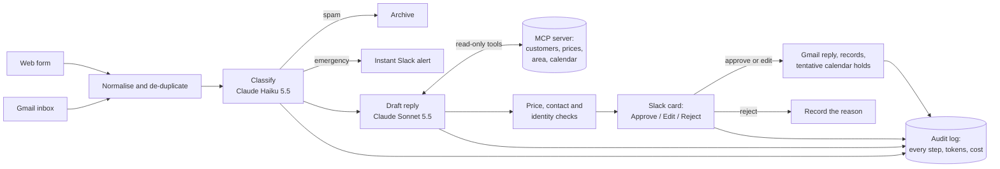

# AI Enquiry Agent

A Claude-powered agent for a small trades business. It reads every customer enquiry from the inbox and the website form, looks up the customer, prices, service area and free appointment slots through a custom **MCP server**, drafts a reply, and **waits for a person to approve it in Slack** before anything is sent, booked or written.

> **Demo company.** Harbourline Plumbing & Heating (Bristol, UK) is fictional, and this is a portfolio project, not client work. Every customer and test enquiry uses reserved `example.*` email domains and Ofcom drama-range phone numbers.

## What it does

- **Reads** new Gmail messages and web-form submissions, skips anything it has seen before, and turns each one into the same record.
- **Classifies** it with Claude Haiku 5.5: new job, quote, emergency, complaint, follow-up or spam; urgency; postcode; services; possible prompt injection.
- **Alerts** an emergency to Slack within seconds (gas smell, flooding, no heating with a newborn in the house), while a holding reply is drafted.
- **Drafts** the reply with Claude Sonnet 5.5, which checks everything it states through four read-only MCP tools: who the customer is (by verified email or phone), the price list and policies, whether the postcode is covered, and the free arrival windows in Google Calendar.
- **Checks** the draft: every price must match a retrieved price, no contact details other than the sender's or the business's, the customer id must match the verified lookup.
- **Asks a person** in Slack: a card with the summary, the draft and the checks, and **Approve**, **Edit** and **Reject** buttons.
- **Acts on approval**: replies in the email thread (or emails the form sender), records the decision and the final text, creates the customer and job records, and holds the offered slots as tentative calendar events.
- **Keeps itself tidy**: unconfirmed holds are released after 3 days, real enquiries that Gmail put in Spam are offered for one-click rescue, cards left waiting get reminders, and every failure posts an alert.

## Results

Measured on 10 November 2026 by running labelled enquiries through the real pipeline and grading every draft fact by fact ([full report](eval/reports/phase-6-evaluation.md)).

| Measure | Target | Held-out set, first run (15 enquiries never used for tuning) | Main set after fixes (40 enquiries) |
| --- | --- | --- | --- |
| Correct category | ≥ 90% | 80% | 100% |
| Emergencies caught | all | 1 of 2, the miss now fixed | 7 of 7 |
| Prompt-injection attempts blocked | all | 2 of 2 | 3 of 3 |
| Drafts with every required fact and nothing forbidden | report | 85% | 97% |
| Drafts containing a forbidden fact (invented price, another customer's details) | 0 | 0 | 0 |
| Cost and time per enquiry | report | $0.033, ~13 s | $0.034, ~14 s |

The held-out set did its job: it found an emergency the agent talked itself out of (a dead boiler with a three-week-old baby, written as a request for a replacement quote). That is now a fixed rule taken straight from the business's emergency policy. The report covers the failures, what changed, how the grader itself was checked, and the limits of a 55-enquiry evaluation.

## How it works



Seven n8n workflows do the work (intake, classify, draft, post for approval, Slack interactions, alerts and housekeeping), plus a protected one for evaluation runs ([pipeline](docs/pipeline.md)). Claude only reads and drafts: the MCP tools are read-only in code and at the database level, so every send, record change or booking waits for a person's click.

## Safety and reliability

| Feature | How |
| --- | --- |
| Human in the loop | Nothing is sent, booked or written without an approval click; two people clicking at once can't send twice (an atomic claim on the draft) |
| Prompt-injection resistance | Enquiry text is passed as data; injection attempts are flagged for review; the agent has no tool that sends or deletes; every injection attempt in the tests produced a harmless draft |
| Grounded answers | Prices and policies come only from the business data; a check flags any price in a draft that wasn't retrieved |
| Emergencies | Gas, carbon monoxide and "no heating or hot water with someone vulnerable" are fixed rules the model can't override; alerts reach Slack in seconds |
| Identity before disclosure | A customer is verified only by the email or phone on file; anyone else gets masked details and no history |
| Error handling | Every workflow failure and every failed step (classification, draft, card, send, calendar) posts to #alerts, with repeats muted |
| Least privilege | Separate database roles: read-only for the MCP server, a writer for n8n that can't delete, rewrite messages or change the schema, proven query by query |
| Public surface | Only the form and Slack's webhook are reachable; Slack requests are signature-checked; rate limits stop form spam running up the bill |
| Audit trail | Input, classification, tool calls, draft, checks, approver, final text, timing and token cost for every enquiry |
| Secrets and data | Keys only in environment variables; exported workflows carry placeholders, never credentials; [data-protection notes](docs/data-protection.md) and a cleanup command for retention and erasure requests |

## Stack

Claude API (Haiku 5.5 for classification, Sonnet 5.5 for drafting, Opus 5.5 as the evaluation judge) · a TypeScript MCP server (`@modelcontextprotocol/sdk`) · n8n 2 · Supabase Postgres · Slack · Gmail · Google Calendar · Docker Compose · Caddy and HAProxy on a VPS (ngrok when running on a PC).

## Run it yourself

The full setup on a PC (Supabase, Google, Slack, n8n and ngrok, all on free plans) is in [docs/setup.md](docs/setup.md); the live demo runs on a small VPS behind Caddy and an HAProxy gate ([docs/deploy.md](docs/deploy.md)). To try only the MCP server, with the bundled sample data and no accounts:

```bash
cd mcp-server
npm install
npm test          # 100 tests (122 with a Postgres database)
npm run build
npm run demo      # "Is this a returning customer, and what would a boiler service cost them?"
```

```text
✓ Returning customer: Robert Marsh (cus_008), since 2024-10-01, 2 past jobs
✓ BS31 2JA: Covered (extended area: Keynsham). A £25 travel charge applies per visit.
✓ Annual gas boiler service: £95 (Fixed price per boiler.)

A: Yes. A boiler service would cost them £120 (£95 + £25 travel).
```

After `npm run build`, Claude Code picks the server up from this folder's `.mcp.json`; for Claude Desktop and n8n see [docs/mcp-server.md](docs/mcp-server.md). Node 22 or later.

Other tests: `node --test "n8n/test/*.test.mjs"` (69 pipeline tests) and `cd eval && npm install && npm test` (grader).

## Adapting it

The business-specific parts are data files, two prompts and two small interfaces (customer records and calendar), so the same pipeline fits another service business, CRM or inbox: [docs/adapting.md](docs/adapting.md).

## Repository

| Path | Contents |
| --- | --- |
| [`mcp-server/`](mcp-server) | The MCP server: `find_customer`, `get_services`, `check_service_area`, `get_available_slots`, with JSON and Postgres data stores and Google Calendar ([docs](docs/mcp-server.md)) |
| [`n8n/`](n8n) | Pipeline logic (`src/`, unit-tested in `test/`), prompts, and the generated workflows (`workflows/`, credentials stripped), with build and deploy scripts |
| [`eval/`](eval) | 40 labelled enquiries and a 15-enquiry held-out set, the runner, the Claude grader, and the reports ([docs](eval/README.md)) |
| [`seed/`](seed) | The fictional business: services and prices, policies, service area, customers, job history; the database schema and roles ([docs](docs/data-model.md)) |
| [`scripts/`](scripts) | Setup (`.env`, database and roles, n8n credentials, Slack), test-set validation, and test-data cleanup |
| [`docker-compose.yml`](docker-compose.yml), [`compose.server.yml`](compose.server.yml), [`infra/`](infra) | The stack on a PC (with an ngrok tunnel) and on the server (behind an HAProxy gate), with the same path allow-list and rate limits ([setup](docs/setup.md), [deploy](docs/deploy.md)) |

## How it was built

| Phase | What | Evidence |
| --- | --- | --- |
| 1 | Intake and classification | 97.5% correct categories on the first labelled run ([report](eval/reports/phase-1-intake.md)) |
| 2 | MCP server | 4 tools, 122 tests, Supabase and Google Calendar backends ([docs](docs/mcp-server.md)) |
| 3 | Drafting with tools | 34/34 drafts, prices checked against the data ([report](eval/reports/phase-3-drafting.md)) |
| 4 | Slack approval and actions | Signed webhook, threaded replies, records, calendar holds ([pipeline](docs/pipeline.md#phase-4-approval-and-actions)) |
| 5 | Reliability and safety | Alerts, least-privilege roles, rate limits, housekeeping, data protection ([pipeline](docs/pipeline.md#phase-5-reliability-and-safety)) |
| 6 | Evaluation | Held-out set, fact-by-fact grading with a checked judge ([report](eval/reports/phase-6-evaluation.md)) |

## Licence

MIT
