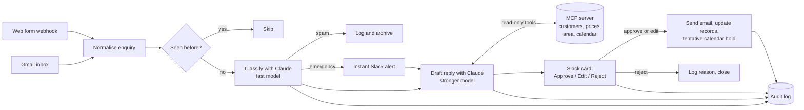

# AI Enquiry Agent

A Claude-powered agent that reads incoming customer enquiries, looks up business context through a custom **MCP server**, drafts a reply, and **waits for a person to approve it** before anything is sent or changed.

> **Demo company.** Harbourline Plumbing & Heating is fictional. Every customer, email address (reserved `example.*` domains) and phone number (Ofcom drama ranges) in this repository is made up.

## How it works



Claude only reads and drafts. The MCP tools are read-only, both in code and at the database level, so every send, record change or booking waits for a person's click in Slack.

## Status

| Phase | What | Status |
| --- | --- | --- |
| 0 | Accounts, n8n hosting, repo, seed data | **Done**: Supabase loaded, Google Calendar seeded, n8n + MCP + ngrok running in Docker ([setup](docs/setup.md)); Slack still to connect |
| 1 | Intake and classification (n8n) | **Done**: web form, Gmail and test webhook → Claude Haiku 5.5 → Supabase. 97.5% category accuracy, every emergency and injection caught ([pipeline](docs/pipeline.md), [report](eval/reports/phase-1-intake.md)) |
| 2 | MCP server | **Done**: 4 tools, 122 tests, Supabase and Google Calendar backends, Docker image |
| 3 | Drafting | **Done**: Claude Sonnet 5.5 tool loop over the MCP server, grounded-price and contact checks, instant emergency alerts in Slack. 34/34 drafts, about $0.03 each ([report](eval/reports/phase-3-drafting.md)) |
| 4 | Slack approval and actions | **Done**: approval card with Approve / Edit / Reject, signature-verified webhook, threaded Gmail replies, customer + job records, tentative calendar holds, outcome on the card ([pipeline](docs/pipeline.md#phase-4-approval-and-actions)) |
| 5 | Reliability and safety | **In progress**: alerts in #alerts for every failed workflow and every handled failure (classification, draft, card, send, calendar holds), with repeat muting ([pipeline](docs/pipeline.md#phase-5-reliability-and-safety)). n8n now writes through a least-privilege database role (no deletes, no rewriting messages or drafts, no schema changes), proven query by query ([data model](docs/data-model.md#database-postgres--supabase)). Next: rate limits, housekeeping, test-data cleanup, data-protection notes |
| 6 | Evaluation | **Labelled test set and intake runner done** (`eval/run-intake.mjs`); drafting scores and a held-out set still to come |
| 7 | Packaging | Not started |

## Repository layout

| Path | Contents |
| --- | --- |
| [`mcp-server/`](mcp-server) | TypeScript MCP server: `find_customer`, `get_services`, `check_service_area`, `get_available_slots` ([docs](docs/mcp-server.md)) |
| [`seed/data/`](seed/data) | Business data as JSON: services and prices, policies, service area, customers, job history, calendar template |
| [`seed/sql/`](seed/sql) | Postgres/Supabase schema, generated seed data, read-only role ([docs](docs/data-model.md)) |
| [`eval/test-set/`](eval/test-set) | 40 labelled test enquiries, including emergencies, complaints, spam and 3 prompt-injection attempts ([docs](eval/README.md)) |
| [`n8n/`](n8n) | Pipeline logic (`src/`, unit-tested in `test/`), generated n8n workflows (`workflows/`, credentials stripped), build and deploy scripts |
| [`scripts/`](scripts) | `.env` setup, database setup, seed SQL generator, test-set validator |
| [`docker-compose.yml`](docker-compose.yml), [`infra/`](infra) | Local stack: n8n, MCP server, and an ngrok tunnel that only exposes webhooks ([setup](docs/setup.md)) |

## Try the MCP server

Requires Node 20+ (22 LTS recommended).

```bash
cd mcp-server
npm install
npm test          # 100 tests; 122 with a Postgres database (see docs/mcp-server.md)
npm run build
npm run demo      # asks "Is this a returning customer, and what would a boiler service cost them?"
```

The demo spawns the server over stdio, the same way Claude Desktop does, and answers using real tool calls:

```text
✓ Returning customer: Robert Marsh (cus_008), since 2024-10-01, 2 past jobs
✓ BS31 2JA: Covered (extended area: Keynsham). A £25 travel charge applies per visit.
✓ Annual gas boiler service: £95 (Fixed price per boiler.)

A: Yes. A boiler service would cost them £120 (£95 + £25 travel).
```

To use it from **Claude Code**, open this folder after `npm run build`; the project's `.mcp.json` registers the server. For **Claude Desktop** and **n8n**, see [docs/mcp-server.md](docs/mcp-server.md).

## Safety by design

- **Read-only tools.** The MCP server has no write methods. In production it connects as a Postgres role that can only `SELECT` five reference tables, and every query runs in a `READ ONLY` transaction. Tests prove that inserts, updates, deletes and reads of pipeline tables are refused.
- **Identity before disclosure.** Customers are only "verified" by the email or phone number on file. A name-only match returns masked details and no address or job history, so someone claiming to be a customer can't extract their data.
- **Grounded prices.** Prices come only from `get_services`, already formatted (`£2,400–£3,800`), so drafts can be checked against what was retrieved.
- **No customer data in logs.** Tool-call logs record which kinds of identifier were supplied, never their values.
- **Authenticated HTTP.** Serving over the network requires a bearer token, compared in constant time.

## Licence

MIT
