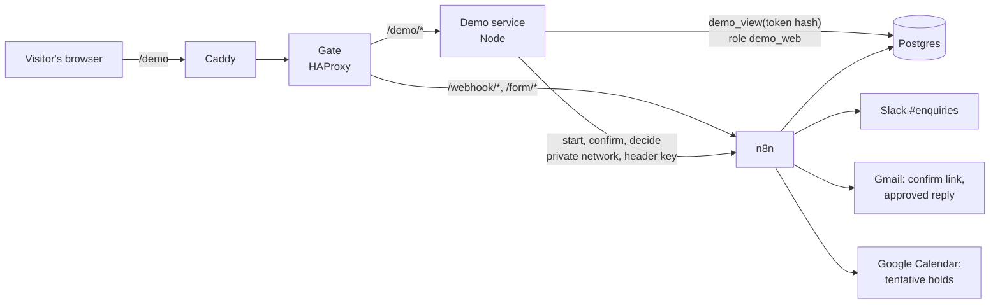

# The live demo page

**https://enquiries.raynors.dev/demo** lets anyone try the agent with their own enquiry, without a Slack account. They watch it go through the real pipeline, then do the business owner's part themselves: approve, edit or reject the draft. If they approve, the reply is emailed to them.

The same enquiry also appears in the demo team's Slack `#enquiries` as a normal approval card, and the card updates when the visitor decides. Approving from the page and approving in Slack run the same workflow.

## What a visitor sees

1. **The form** (`/demo`): name, email, postcode, what it's about, message. Three examples fill it in: a quote request, a gas emergency and a prompt-injection attempt.
2. **A confirmation email** with a link. Opening it shows a **Start my demo** button; nothing starts until it's pressed, so email security scanners that open every link can't start a demo.
3. **The live page**, updated every 2 seconds:
   - how Claude Haiku classified the enquiry (category, urgency and why, safety flags, a quoted injection attempt if there was one)
   - the draft: which tools Claude Sonnet used, the price and contact checks, the appointment slots it offered, and anything flagged for a person
   - a timeline of every step with its duration and AI cost
   - the bookings calendar (public, read-only), where approved replies add tentative holds
4. **The decision**: approve, edit the text and send that, or reject with a reason. The page then shows what happened: emailed or not, customer and job records created, calendar holds added, Slack card updated.

A typical run reaches the decision stage in 15 to 30 seconds and costs about $0.03 in Claude calls.

## How it fits together

| Part | What it does |
| --- | --- |
| [`demo/`](../demo) | A small Node service (`node:http` and `pg`, no framework) that serves the three pages and a JSON API. It never touches a table: it calls n8n for every change and reads state through one database function |
| n8n workflow **Harbourline · Demo** ([`n8n/build.mjs`](../n8n/build.mjs)) | Three webhooks, protected by a header key that only the demo service has. **Start**: checks the daily limits, records a pending submission, emails the confirm link. **Confirm**: marks it confirmed (once), then runs the normal classify, draft and Slack card steps. **Decide**: finds the session's draft and calls **Decide reply**, the same sub-workflow as Slack's buttons |
| `demo_sessions` table | Pending and confirmed submissions. The link's token is stored only as its SHA-256 hash |
| `demo_view(token_hash)` | A `SECURITY DEFINER` function that returns one session's own enquiry, classification, draft, timeline and outcome, without database ids, contact details or audit details |
| Role `demo_web` | The demo service's database login. It can run `demo_view` and nothing else; `scripts/db-setup.mjs` proves it can't read or write any table |
| Housekeeping, 03:30 daily | `purge_demo_data(7)` deletes demo enquiries older than 7 days with everything made from them, and n8n deletes their Slack cards |

## Security

| Risk | What stops it |
| --- | --- |
| Someone uses another person's email address | Nothing runs until the confirm link sent to that address is used, so replies only ever go to an address whose owner pressed the button. The confirm email contains no text from the form except a plain first name (letters only), so it can't carry someone else's link or advert. Each address gets at most 3 confirm emails a day |
| Guessing or leaking a private link | Links carry 32 random bytes. They sit in the URL fragment (`/demo/e#…`), which browsers never send to a server, so they never appear in Caddy's, the gate's or the service's logs, or in a referrer. The API takes them in POST bodies, and only their SHA-256 leaves the demo service. An unknown link gets a 404 |
| Cross-site scripting through enquiry or model text | Every value is shown with `textContent`, never as HTML. The Content Security Policy allows only the site's own scripts and styles (no inline code at all) and frames only from `calendar.google.com`; `frame-ancestors 'none'` stops the page being framed |
| Requests forged from another site | Every API call must come from the site's own origin, as JSON, at most 16 KB |
| Running up the Claude bill | The gate counts demo submits and confirms with the web form: 5 per 10 minutes per IP, 20 an hour in total. On top of that, n8n allows 60 submissions and 30 confirmed runs a day (`DEMO_CAPS` in `n8n/build.mjs`) |
| Bots | A hidden form field that people never fill in; bots that fill it get a fake success and nothing is sent |
| Reaching n8n's demo webhooks directly | The gate refuses them publicly, including spellings with `//`, `/./`, `/../` or `%`-encoding; the service calls them on the private Docker network. They also need the header key |
| Prompt injection | Handled by the normal pipeline: flagged, shown to the visitor and on the Slack card, and the agent has no tool that sends or deletes. An approved reply can only go to the visitor's own confirmed address |
| A public calendar showing personal data | Hold titles are only the catalogue service and postcode district (`HOLD (tentative): boiler repair · BS6`), for every enquiry, never a name or anything the sender typed |
| The demo service itself | Read-only container, no Linux capabilities, non-root, 128 MB, on the private network only |

Limits worth knowing: someone could use up the day's 60 submissions with throwaway addresses, which would pause the demo until the next day (the gate's per-IP limit slows this down). Caddy's shared settings set `Referrer-Policy: strict-origin-when-cross-origin` rather than the service's `no-referrer`; tokens are in the fragment, which is never sent as a referrer either way.

## Data

Visitors' data is real personal data: name, email, postcode, message, and the reply sent to them. The database records, draft and Slack card are kept for **7 days** and then deleted automatically (unconfirmed submissions after a day); calendar holds go after 3 days. Copies of the confirmation and reply emails stay in the demo mailbox's Sent folder until it's tidied by hand. See [data protection](data-protection.md); the page and the confirmation email say the same.

## Running it

The demo runs in the server's Compose stack ([deploy](deploy.md)) and needs, in `.env`:

| Key | From |
| --- | --- |
| `DEMO_DB_URL` | `node scripts/db-setup.mjs` (creates the `demo_web` role) |
| `DEMO_N8N_KEY` | `node scripts/init-env.mjs` (generated); `node scripts/n8n-credentials.mjs` creates the matching n8n credential |
| `DEMO_CALENDAR_EMBED_URL` | Optional. Google Calendar → the calendar's settings → make it public with *See all event details* → *Integrate calendar* → the `src` of the embed code. Use `ctz=Europe/London`. Empty: no calendar on the page |

Tests: `cd demo && npm install && npm test` (validation, state shaping, and the HTTP service end to end with n8n and the database replaced by fakes), plus the demo cases in `node --test "n8n/test/*.test.mjs"`. `scripts/db-setup.mjs` checks the `demo_web` role and replays the Demo workflow's queries as `n8n_writer`.
