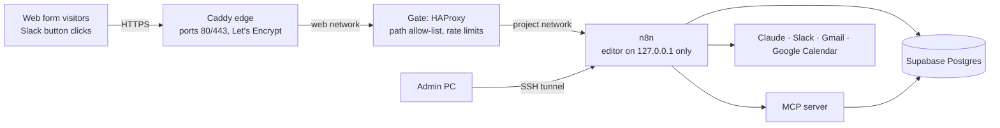

# Deploy: the portfolio server

The live demo runs at **https://enquiries.raynors.dev** on the portfolio VPS (Ubuntu, Docker), next to the other demos. The server itself (hardening, firewall, Docker, and the shared Caddy reverse proxy with automatic HTTPS) is set up by the separate `raynors-infra` repo. Running on a PC instead, with an ngrok tunnel, is covered in [setup.md](setup.md).



## How it runs

- **[`compose.server.yml`](../compose.server.yml)** runs three containers: n8n, the MCP server and the gate. Only the gate joins the shared `web` network that Caddy uses; n8n and the MCP server stay on the project's own network. Nothing publishes a public port, so nothing bypasses the server's firewall.
- **The gate** ([`infra/gate/haproxy.cfg`](../infra/gate/haproxy.cfg)) applies the same rules the ngrok traffic policy applies on a PC: only `/webhook/*` and `/form/*` reach n8n (the editor, its API and the evaluation webhook get 404), at most 120 requests a minute per client IP, and form submissions capped at 5 per 10 minutes per IP and 20 an hour in total (429 with `Retry-After`).
- **The n8n editor** is bound to the server's `127.0.0.1:5678` and reached through an SSH tunnel, so it is still `http://localhost:5678` on the admin PC. Google's OAuth redirect (`http://localhost:5678/rest/oauth2-credential/callback`) keeps working unchanged, and the scripts that use n8n's API (`n8n/deploy.mjs`, `n8n-credentials.mjs`, the evaluation runner) work through the same tunnel.
- **Hardening**, as for the other demos: no Linux capabilities, `no-new-privileges`, memory and process limits; the MCP server and the gate also run with read-only filesystems.
- **Settings** come from `/srv/ai-enquiry-agent/.env` (mode 600): the same keys as on a PC, plus `PUBLIC_HOST=enquiries.raynors.dev` and the server path of the Google service account key (`/srv/ai-enquiry-agent/secrets/`, mode 600).
- **Data:** n8n's workflows, credentials and execution history are in the `harbourline_n8n_data` Docker volume (14-day execution pruning). Everything else is in Supabase, as before.

## Open the editor

```bash
ssh -N -L 5678:127.0.0.1:5678 raynors-vps    # leave running, then open http://localhost:5678
```

Stop any local n8n first (`docker compose down` in this folder on the PC), so port 5678 is free and only one n8n ever polls the Gmail inbox.

## Deploy a new version

From the repo on the admin PC, after pushing to `main`:

```bash
ssh raynors-vps 'cd /srv/ai-enquiry-agent && git pull --ff-only && docker compose -f compose.server.yml up -d --build'
# with the tunnel open: update the workflows in n8n
node n8n/deploy.mjs
```

To change a setting, edit the server's `.env` (or copy an edited one up) and restart:

```bash
ssh raynors-vps 'chmod 600 /srv/ai-enquiry-agent/.env && cd /srv/ai-enquiry-agent && docker compose -f compose.server.yml up -d'
```

After changing the gate's rules: `ssh raynors-vps 'docker restart harbourline-gate'`. After changing the Caddyfile in `raynors-infra`, pull it on the server and reload Caddy (see that repo's README).

## Moving from a PC to the server (one time)

1. DNS: an `A` record `enquiries.raynors.dev` → the server's IP in Cloudflare, DNS only.
2. On the server: clone this repository to `/srv/ai-enquiry-agent`, copy the `.env` (with `PUBLIC_HOST` and the server key path) and the Google service account key, both mode 600.
3. Stop n8n on the PC, copy its `harbourline_n8n_data` volume to the server and restore it into the volume of the same name, so the workflows, credentials (including the Google sign-ins), API key and history carry over. The `N8N_ENCRYPTION_KEY` must stay the same.
4. `docker compose -f compose.server.yml up -d --build`, add the site to the Caddyfile and reload Caddy.
5. In the Slack app settings, point **Interactivity → Request URL** at `https://enquiries.raynors.dev/webhook/slack-interactions`.
6. Check: the form loads, the editor and the evaluation webhook get 404, an unsigned Slack request gets 401, the rate limits answer 429, and a real enquiry goes from the form to an approval card.
