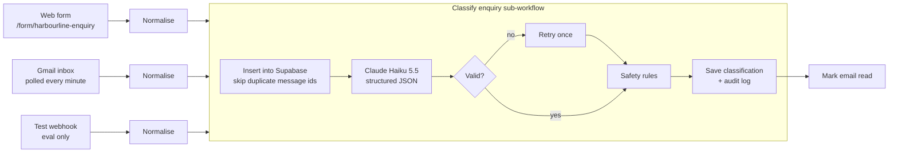
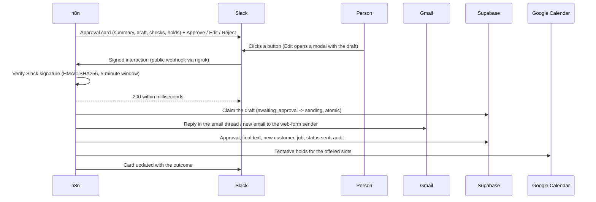

# Pipeline

## Phase 1: intake and classification

### One record shape

Every source becomes the same record (`n8n/src/lib/normalise.mjs`): source, message id, sender name, email and phone, subject, body, form fields, time received, and a test flag. Message ids are `gmail:<id>`, `form:<execution id>` or `test:<run>:<enquiry id>`. Bodies longer than 20,000 characters are cut and flagged, never silently dropped.

### Classification

The classifier (`n8n/src/lib/classification.mjs`, prompt in `n8n/src/prompts/classify-system.md`) sends one request to Claude Haiku 5.5:

- **Output and effort:** effort `low`, with a strict JSON schema enforced by structured outputs.
- **What comes back:** category, urgency and its reason, a one-line summary, contact details, postcode, location, the services involved (limited to the business's own service ids), any references, whether someone vulnerable is in the property, safety flags, an injection flag with evidence, and whether a person should review it.
- **Customer text is data:** the message is wrapped in tags, and the customer's text can't contain our tag names, so it can't fake the end of the data block.
- **Validation:** the reply is read by block type, because thinking blocks can come first, then checked against the schema again in code.
- **Failure handling:**
  - Transient API errors are retried by n8n with a pause.
  - Invalid output is retried once.
  - A refusal, or a second failure, marks the enquiry `needs_review`.

### Safety rules after the model

These deterministic rules override the model, and each override is written to the audit log:

- **Emergencies:** a gas smell or a carbon monoxide alarm is always an emergency, and so is a total loss of heating or hot water with someone vulnerable in the home (the business's emergency policy), however the customer frames it. The last rule was added in Phase 6, after the held-out set showed the model talking itself out of it ([report](../eval/reports/phase-6-evaluation.md)).
- **Consistency:** emergency category and emergency urgency always go together.
- **Injection:** classic injection phrasing ("ignore previous instructions", "admin mode", "approve this automatically") flags the enquiry for a person, even if the model missed it.

### Statuses

| Status | When |
| --- | --- |
| `classified` | Ready for drafting (Phase 3). Suspicious enquiries are `classified` with `is_suspicious = true` |
| `archived` | Spam, unless it looks like an attack |
| `needs_review` | Classification failed or was refused |
| `duplicate` | Returned by the workflow when a message id was already processed; nothing is written |

### Audit log

Each enquiry gets an `intake/received` row, then a `classify/...` row holding:

- the model, input and output tokens, cost in USD and time taken
- every attempt (stop reason, error), any overrides, and the resulting status

### Measured accuracy

See [eval/reports/phase-1-intake.md](../eval/reports/phase-1-intake.md). On the 40 labelled enquiries:

- **Category:** 97.5% correct.
- **Emergencies and injections:** every emergency caught and every injection flagged, with no false alarms.
- **Cost and speed:** about $0.0006 and 2.3 s per enquiry.

## Phase 3: drafting

The **Draft reply** sub-workflow runs for every enquiry with status `classified`. Spam, failures and duplicates are skipped.

1. **Emergency alert.** If the urgency is emergency (and it isn't a test), n8n posts an alert to **#alerts** straight away. All customer text in it is escaped, so a message can't ping `@channel` or fake links.
2. **Tools from the MCP server.** n8n asks the MCP server for its tools (`tools/list` over Streamable HTTP, with a bearer token) and passes them to Claude as tool definitions.
3. **Tool loop.** Claude Sonnet 5.5 drafts with up to 6 turns. The loop is unrolled into separate nodes, so every turn is visible in the n8n editor.
   - **Each turn:** Claude's tool calls are sent to the MCP server (`tools/call`), and all results go back in one message.
   - **Thinking blocks:** each assistant turn, thinking blocks included, is passed back unchanged.
   - **Last turn:** sets `tool_choice: none`, so the model has to answer.
   - **Repeats:** a repeated lookup is marked as a repeat, and each set of results ends with a reminder to answer once the facts are in.
4. **Structured draft.** The draft comes back as JSON: subject, body, reasoning for the reviewer, verified customer id, prices quoted with their sources, slots offered, confidence, and whether a person must decide something.
5. **Independent checks** (`n8n/src/lib/drafting.mjs`):
   - **Prices:** every £ amount must be a figure a tool returned, or simple arithmetic on those figures (a sum, a quantity up to ×10, or a percentage the tools state). Figures the customer wrote are allowed too.
   - **Contacts:** no email address or phone number other than the sender's, the business's, or 0800 111 999.
   - **Customer:** the customer id must match a verified `find_customer` result, never a name-only match.
6. **Save.** The draft goes into `drafts`. The enquiry becomes `drafted` and is linked to the verified customer. The audit log records every turn (model, stop reason, tools), every tool call with its input and output, both checks, the review reasons, and tokens, cost and time.

Request settings:

| Setting | Value | Why |
| --- | --- | --- |
| Model | `claude-sonnet-5-5` | Writing quality and dependable tool use |
| `output_config.effort` | `medium` | The recommended starting level for multi-step tool use |
| `output_config.format` | JSON schema | The draft always parses |
| `fallbacks` | `"default"` (beta `server-side-fallback-2026-07-01`) | If a safety classifier declines, another model answers instead of the draft failing |
| `cache_control` | Automatic | The system prompt, tools and earlier turns are cached across the loop |
| Sampling parameters, forced `tool_choice` | Not sent | This model rejects both |

Measured results: [eval/reports/phase-3-drafting.md](../eval/reports/phase-3-drafting.md).

## Phase 4: approval and actions

| What | How |
| --- | --- |
| Card | Posted to **#enquiries** by the **Post for approval** sub-workflow after every live draft (never for tests); a failed draft gets a "manual reply needed" card. Customer text is escaped; **Approve** asks for confirmation; the **Edit** button carries the draft text so the modal opens instantly (Slack allows 3 s) |
| Request verification | Slack signs every request; the **Slack interactions** workflow checks the signature over the raw body with a pure-JavaScript HMAC-SHA256 (n8n's Code sandbox blocks `crypto`), rejects anything older than 5 minutes, and answers Slack immediately |
| No double sending | The first click atomically moves the enquiry from `awaiting_approval` to `sending`; any later click on the same card finds nothing to claim and does nothing |
| Sending | Only ever to the stored sender address. Email enquiries are answered **in their thread** (reply-to-sender-only); web-form enquiries get a new email. Reserved test domains (`example.com`, `*.example`, ...) are **simulated**, never sent, so they can't bounce back into the inbox. The Gmail trigger ignores the mailbox's own messages, so replies never loop back in as enquiries |
| Records | `approvals` (decision, who, Slack user id, final subject and text, send mode); a new `customers` row for senders who weren't verified customers; a `jobs` row for bookings, quotes and emergencies; enquiry status `sent` / `rejected` / `failed` |
| Calendar | One tentative, opaque, yellow "HOLD" event per offered slot, tagged with the enquiry id (`extendedProperties.private.harbourlineHold`) so holds can be found and cleared |
| Edits | The edited text is stored next to the AI draft, for improving prompts later |
| Card outcome | Buttons are replaced by "Sent / Edited and sent / Rejected / Sending failed", who did it, holds added and records created; an edited reply shows the text actually sent |

The signing secret reaches the verification node at deploy time only (`__SECRET__` placeholder, strict allowlist and format check in `n8n/deploy.mjs`); the committed workflow files never contain it.

Tested: unit tests (HMAC checked against Node's `crypto` on 300 random inputs, routing, cards, modals, email plans); security checks through the public tunnel (no / forged / tampered / replayed signatures all get 401); a synthetic end-to-end run of approve, double-approve, edit-submit, reject and edit-open against the real workflows, database and calendar; and a live run (web form → card → Edit → email received, card updated, three tentative holds, customer and job created). All 34 enquiries that needed a reply got a draft. After the fixes, a draft averages 2.2 turns, about $0.03 and about 10 s.

## Phase 5: reliability and safety

### Alerts in #alerts

Nothing fails silently. The **Alerts** workflow posts to **#alerts** in two cases:

| Case | How it's caught | What the alert says |
| --- | --- | --- |
| A workflow fails (database down, expired credential, a bug in a step) | Every workflow names Alerts as its n8n **error workflow** (`settings.errorWorkflow`); the Error Trigger receives the failed execution | Workflow, failing step, error message, execution id |
| A step fails but the workflow carries on | A side branch after the step's audit record calls Alerts directly | What happened, what a person should do, sender, subject, enquiry id |

Handled failures that alert:

| Kind | Where | What it means |
| --- | --- | --- |
| `classification_failed` | Classify | Claude couldn't classify the enquiry after a retry, so nothing was drafted or posted: the alert is the only signal |
| `draft_failed` | Draft | No draft; the enquiry will appear in #enquiries as a manual-reply card |
| `card_failed` | Post for approval | Slack refused the approval card, so the enquiry isn't in #enquiries |
| `send_failed` | Slack interactions | An approved reply didn't go out (Gmail error, no valid address); the enquiry is marked `failed` |
| `holds_failed` | Slack interactions | The reply went out but some offered slots weren't held in the calendar |

Design points:

- **No floods.** Repeats of the same workflow error (same step, same message, ignoring numbers) are muted for 30 minutes, then the next alert says how many were muted, so a poller that fails every minute posts once. The memory lives in the Alerts workflow's static data, and a run only writes it when it changes something, so parallel runs don't overwrite each other.
- **One alert per incident.** When a sub-workflow fails, n8n raises the error in the sub-workflow *and* in its caller. The caller's error names the sub-execution, so Alerts drops it and posts only the sub-workflow's (more precise) alert.
- **Tests stay quiet.** Handled failures on test enquiries don't alert (evaluation runs report their own failures); a crashed test run still does, because that's a system problem.
- **Alerts never break the pipeline.** The call to Alerts is fire-and-forget and set to continue on error, and the side branch sits above the main path so a sub-workflow still returns its normal result (n8n's v1 execution order runs the topmost branch first).
- **Safe content.** Error messages and customer text are escaped (no `@channel`, no fake links), truncated, and posted without links or stack traces. If Slack itself refuses an alert, the Alerts execution fails so it shows in n8n's execution list.

Tested: unit tests for the alert logic (shapes taken from real Error Trigger output) and for the exact code deployed in each alert branch, run against stubbed upstream outputs; the build checks that every `$("Node")` reference exists and every Code node compiles. Live: a deliberately broken test enquiry produced one alert (not two) and the repeat was muted; an approved synthetic enquiry with no email address produced a "reply was not sent" alert; the synthetic approve / edit / reject run produced no false alerts.

### Least-privilege database access

n8n no longer connects as the database admin. Its Postgres credential uses the `n8n_writer` role, which can do exactly what the workflows do and nothing else: it can add rows and move an enquiry through its statuses, but it can't delete or truncate anything, rewrite a customer's message, a draft or an approval after the fact, read audit details, or change the schema. Updates are granted per column (an enquiry's status, classification and customer link; a draft's Slack location), so the audit trail can't be quietly edited even by a buggy or compromised workflow. See the [roles table](data-model.md#database-postgres--supabase).

Tested: `scripts/db-setup.mjs` replays all 11 workflow queries as `n8n_writer` in pipeline order with the same parameters n8n sends (rolled back, no rows left) and checks that 10 forbidden statements are refused; a unit test fails if a workflow gains a query that isn't in that replay. After switching the credential, n8n's own connection test passed, the synthetic approve / edit / reject run and a classify + draft smoke test wrote their records normally, and the database showed n8n's connections as `n8n_writer`.

### Rate limits on the public tunnel

Only two things are public: the web form and the webhooks (Slack's interactions). The ngrok traffic policy (`infra/ngrok-policy.yml`) limits them before they reach n8n:

| Limit | Why |
| --- | --- |
| 120 requests a minute per client IP, on every public path | Stops floods of forged Slack requests or page loads from filling n8n's execution log (forged Slack requests are already refused by the signature check) |
| 5 form submissions per 10 minutes per client IP | Each submission is classified and drafted with Claude (about $0.04), so one person can't run up the bill |
| 20 form submissions an hour in total | The same, for many addresses at once: at most about $0.80 an hour, on top of the spending limit set in the Anthropic console |

Over a limit, ngrok answers `429 Too Many Requests` with a `retry-after` header, and n8n never sees the request. ngrok counts per ingress server, so the totals are approximate. The evaluation webhook is no longer reachable through the tunnel at all; the evaluation runner calls it on localhost.

Tested through the public address: the form page loads; the editor, login, REST API and evaluation webhook get 404; an unsigned Slack request gets 401 and a genuine signed one 200; and a burst of six form submissions to a form path that doesn't exist (so n8n starts nothing) got five 404s from n8n and then a 429 from ngrok.

### Housekeeping

A scheduled **Housekeeping** workflow (UK time) keeps the system tidy without anyone remembering to:

| Job | When | What it does |
| --- | --- | --- |
| Release unconfirmed holds | Daily 07:00 | Each tentative hold records its expiry (3 days after the reply) and says in its description how to keep it. Holds past expiry that still look like holds (tagged, tentative, title starting "HOLD") are deleted, the enquiry's audit log records it, and a note goes in the approval card's thread. Renamed or confirmed holds and the demo bookings are never touched |
| Rescue real enquiries from Spam | 08:00 and 14:00 | Unread mail that arrived in Gmail's Spam folder since the last check is matched against words the business cares about (boiler, leak, radiator, quote, ...). Matches are listed in **#alerts**, each with a **Process** button; ordinary spam is left alone. Process fetches the email and runs it through the normal pipeline (classify, draft, approval card), then moves it to the inbox and marks it read, and replies in the alert's thread with the result. This is needed because Gmail's trigger never sees mail moved out of Spam (it only looks for mail newer than its last check) |
| Delete old demo data | Daily 03:30 | Runs `purge_demo_data(7)`: live demo page enquiries older than 7 days are deleted with their drafts, approvals, audit rows, jobs, the customers created from them and their sessions (unconfirmed submissions after a day), and their Slack cards are deleted. It is the only deletion `n8n_writer` can make ([demo](demo.md)) |
| Remind about waiting cards | Hourly 08:00-18:00, Mon-Sat | Approval cards still waiting get a reminder in their thread (also shown in the channel): after 30 minutes for emergencies (then hourly), 1 hour for high urgency (then every 4 hours), 4 hours for normal (then daily), a day for low. Each reminder is logged, so none is repeated early |

The rescue only ever creates an approval card; nothing is emailed without a person approving it, and pressing Process twice does nothing new (message ids are unique). Reminders read only which event happened when from the audit log (`n8n_writer` can't read audit details).

Tested: unit tests for every rule (expiry and the round trip from hold creation to release, word matching with word boundaries, reminder timing per urgency, Slack escaping). Live, with synthetic data and a temporary copy of the workflow whose schedules were swapped for webhooks: an expired hold was released while a renamed one, one not yet due and the real holds stayed; a card waiting 5 hours got one reminder and no second one an hour later; of two emails placed in Spam, the leaking-pipe one was listed and the casino one wasn't; pressing Process (a correctly signed Slack request) took it through classification and drafting to an approval card for $0.038, moved it to the inbox and replied in the thread. Everything synthetic was removed afterwards.
