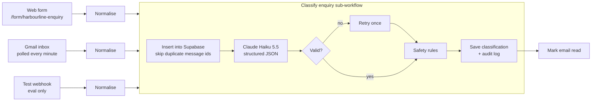

# Pipeline

## Phase 1: intake and classification

### One record shape

Every source becomes the same record (`n8n/src/lib/normalise.mjs`): source, message id, sender name, email and phone, subject, body, form fields, time received, and a test flag. Message ids are `gmail:<id>`, `form:<execution id>` or `test:<run>:<enquiry id>`. Bodies longer than 20,000 characters are cut and flagged, never silently dropped.

### Classification

The classifier (`n8n/src/lib/classification.mjs`, prompt in `n8n/src/prompts/classify-system.md`) sends one request to Claude Haiku 5.5:

- **Output and effort:** effort `low`, with a strict JSON schema enforced by structured outputs.
- **What comes back:** category, urgency and its reason, a one-line summary, contact details, postcode, location, the services involved (limited to the business's own service ids), any references, whether someone vulnerable is in the property, safety flags, an injection flag with evidence, and whether a person should review it.
- **Customer text is data:** the message is wrapped in tags, and the customer's text can't contain our tag names, so it can't fake the end of the data block.
- **Validation:** the reply is read by block type, because thinking blocks can come first, then checked against the schema again in code.
- **Failure handling:**
  - Transient API errors are retried by n8n with a pause.
  - Invalid output is retried once.
  - A refusal, or a second failure, marks the enquiry `needs_review`.

### Safety rules after the model

These deterministic rules override the model, and each override is written to the audit log:

- **Emergencies:** a gas smell or a carbon monoxide alarm is always an emergency.
- **Consistency:** emergency category and emergency urgency always go together.
- **Injection:** classic injection phrasing ("ignore previous instructions", "admin mode", "approve this automatically") flags the enquiry for a person, even if the model missed it.

### Statuses

| Status | When |
| --- | --- |
| `classified` | Ready for drafting (Phase 3). Suspicious enquiries are `classified` with `is_suspicious = true` |
| `archived` | Spam, unless it looks like an attack |
| `needs_review` | Classification failed or was refused |
| `duplicate` | Returned by the workflow when a message id was already processed; nothing is written |

### Audit log

Each enquiry gets an `intake/received` row, then a `classify/...` row holding:

- the model, input and output tokens, cost in USD and time taken
- every attempt (stop reason, error), any overrides, and the resulting status

### Measured accuracy

See [eval/reports/phase-1-intake.md](../eval/reports/phase-1-intake.md). On the 40 labelled enquiries:

- **Category:** 97.5% correct.
- **Emergencies and injections:** every emergency caught and every injection flagged, with no false alarms.
- **Cost and speed:** about $0.0006 and 2.3 s per enquiry.
